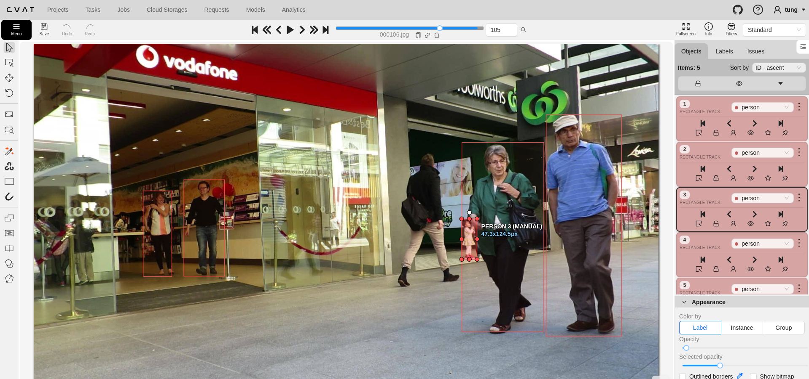
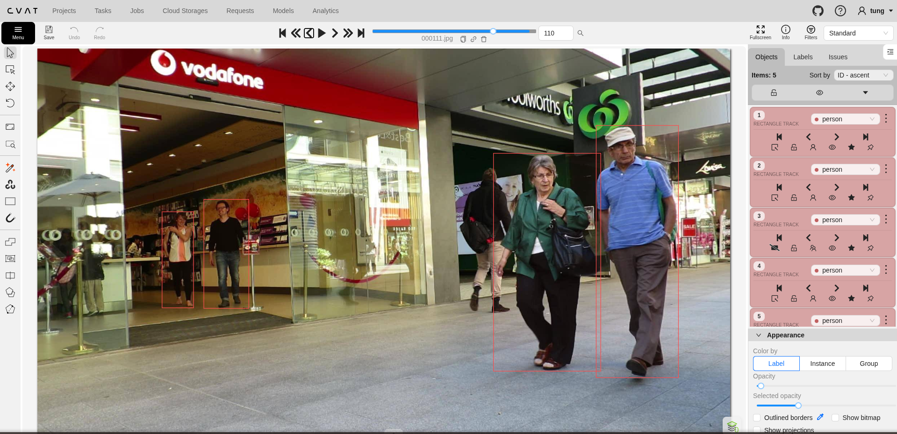
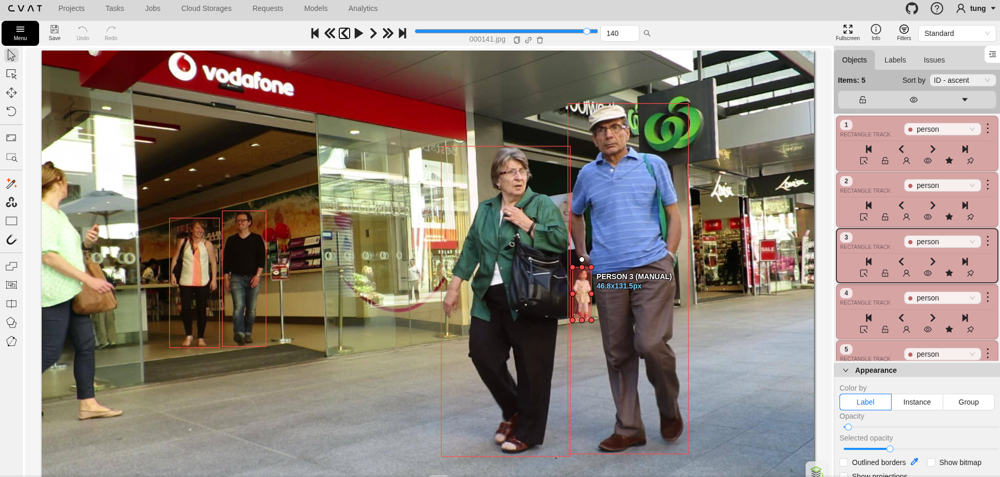
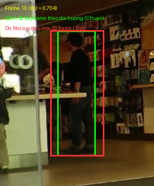

# Báo cáo cá nhân — NguyenKhanhTung-2A202603144

Đoạn video: MOT17-09, 150 frame (frame 1–150), nguồn MOTChallenge, giấy phép CC BY-NC-SA 3.0.

## 0. Thông tin học viên

- Họ tên: Nguyễn Khánh Tùng
- MSSV: 2A202603144
- Mã đề (A/B/C): A
- Email: sfpcshch@gmail.com
- Link repository: https://github.com/sfpcshch/K5-L2-NguyenKhanhTung-2A202603144-MOTTracking
- Giờ bắt đầu: 16:20
- Giờ kết thúc: 19:10

## 1. Xem trước đoạn video (CP0)

Ghi **trước khi vẽ**, mỗi người một dòng.

| Mã | Frame xuất hiện | Frame cuối thấy được | Rẽ / dừng / đổi tốc độ ở frame | Bị che ở frame | Ghi chú |
|---|---|---|---|---|---|
| P1 | 0 | 149 | 20, 30, 50, 60, 129, 130 | 27–59 (khuất hẳn 39–49) | Áo len đen trong shop Vodafone, bị P2 che khuất hoàn toàn một đoạn ngắn 11 frame |
| P2 | 60 | 149 | 60, 70, 80, 100, 120, 140 | 60–69 | Áo khoác đen quần sáng, đi ngang shop Vodafone từ trái sang phải với vận tốc ổn định |
| P3 | 0 | 149 | 0, 40, 80, 110, 140 | Không bị che | Áo xanh kẻ caro đi từ phải sang trái, chuyển động thẳng đều, kích thước tăng dần khi tiến gần camera |
| P4 | 0 | 149 | 0, 30, 70, 110, 142 | Không bị che | Áo xanh sẫm đi sát lề mép phải, box hẹp, tốc độ tương đối ổn định |
| P5 | 0 | 145 | 30, 60, 106, 136, 145 | 106–145 (khuất hẳn 110–135) | Bé gái áo trắng, bị người lớn đi cùng che lấp kéo dài và khuất hẳn sau frame 145 |

## 2. Keyframe và thời gian (CP1, CP4)

Số keyframe lấy từ kết quả `src/check_submission.py`.

| Mã | Số keyframe | Keyframe ở frame | Số frame có mặt | Keyframe / 100 frame | Thời gian (phút) | Chỗ khó |
|---|---|---|---|---|---|---|
| P1 | 21 | 0, 10, 20, 27, 30, 50, 51, 52, 53, 54, 60, 70, 80, 90, 100, 110, 120, 129, 130, 140, 149 | 139 | 15.1 | 22 | Bị che khuất phức tạp (occluded và outside do người đi ngoài che lấp), khúc kính phản chiếu shop Vodafone và lúc tái xuất hiện |
| P2 | 10 | 60, 70, 80, 90, 100, 110, 120, 130, 140, 149 | 90 | 11.1 | 10 | Xuất hiện từ frame 60, ban đầu bị che một phần bởi mép cửa sau đó đi đều ngang màn hình |
| P3 | 16 | 0, 10, 20, 30, 40, 50, 60, 70, 80, 90, 100, 110, 120, 130, 140, 149 | 150 | 10.7 | 12 | Tiến gần về phía camera khiến kích thước box tăng dần, cần điều chỉnh nở đều |
| P4 | 17 | 0, 10, 20, 30, 40, 50, 60, 70, 80, 90, 100, 110, 120, 130, 140, 142, 149 | 150 | 11.3 | 12 | Di chuyển sát lề mép phải, box hẹp, cử động sải chân làm thay đổi nhẹ tỉ lệ box |
| P5 | 20 | 0, 10, 20, 30, 40, 50, 60, 70, 100, 106, 109, 136, 137, 138, 139, 140, 141, 142, 143, 145 | 120 | 16.7 | 18 | Đối tượng nhỏ, bị người lớn che lấp 26 frame (110–135), tái xuất hiện ngắn rồi biến mất hẳn |
| **Tổng** | **84** | - | **649** | **12.9** | **74** | - |

Keyframe / 100 frame của cả bài = tổng keyframe ÷ tổng số frame có mặt × 100 = 84 ÷ 649 × 100 = **12.9 keyframe / 100 frame**.

Bạn đặt keyframe nhiều nhất ở người nào? Vì sao (người đó rẽ, dừng, lại gần camera hay bị che)?

Người được đặt keyframe nhiều nhất là **P1 (21 keyframe)** và **P5 (20 keyframe)** với mật độ lần lượt là 15.1 và 16.7 keyframe / 100 frame:
- **P1** là đối tượng có tình huống che khuất phức tạp nhất trong bài: P1 đi phía trong cửa hàng Vodafone thì bị người đi bộ phía trước chắn ngang tầm nhìn, chuyển từ trạng thái thấy rõ sang che một phần (`occluded` từ frame 27–38), khuất hoàn toàn (`outside` từ frame 39–49), tái xuất hiện che một phần (frame 50–59) rồi thấy rõ trở lại từ frame 60. Do thuật toán nội suy tuyến tính của CVAT giả định vận tốc và kích thước không đổi, việc cắm keyframe dày đặc quanh vùng ranh giới che khuất (các frame 27, 30, 50, 51, 52, 53, 54, 60) là bắt buộc để amodal box bám sát thực tế và không bị giật, trôi lệch khi ra/vào điểm che.
- **P5** có vóc dáng nhỏ và bị người lớn đi cùng che lấp kéo dài 26 frame (từ 110 đến 135), sau đó xuất hiện lại trong một đoạn ngắn (frame 136–145) với bước chân biến đổi trước khi khuất hẳn khỏi khung hình ở frame 146. Do đó, cần đặt các keyframe liên tục ở đoạn cuối để cố định box chính xác.

## 3. Đoạn bị che (CP2)

Người bị che: `P1`

| Mốc | Frame |
|---|---:|
| Bắt đầu bị che một phần (bật `occluded`) | 27 |
| Mất hẳn (bật `outside`) | 39 |
| Hiện lại (tắt `outside`) | 50 |
| Thấy rõ trở lại (tắt `occluded`) | 60 |

- Thời gian khuất hẳn: 11 frame = 11 / 30 ≈ 0.37 giây.
- Quyết định: **giữ cùng ID** (Track ID 4 trong file MOT, Track ID 3 trong CVAT).
- Lý do:
  1. *Khuất bao lâu so với ngưỡng 60 frame:* Thời gian khuất hoàn toàn chỉ kéo dài 11 frame (~0.37 giây), nhỏ hơn rất nhiều so với ngưỡng 60 frame (2 giây) của guideline.
  2. *Ngoại hình có khớp:* Vóc dáng nam giới, chiều cao, kiểu tóc và trang phục áo len sẫm màu bên trong cửa hàng Vodafone hoàn toàn trùng khớp giữa thời điểm trước khi bị che (frame 20–38) và sau khi tái xuất hiện (frame 50–60).
  3. *Chỗ hiện lại có đúng hướng và tốc độ:* Trước khi che, P1 đi từ trái sang phải với tốc độ ổn định bên trong cửa hàng; tại frame 50 vị trí người đó bước ra sau chướng ngại vật nằm đúng trên đường kéo dài của vector vận tốc, tiếp tục sải bước đều sang phải không có sự dịch chuyển đột ngột hay bất thường.

Ảnh chụp màn hình:





## 4. Tự review ID (CP3)

Lượt 1 theo người (đi ngược từ frame 149 về 0 trên CVAT), lượt 2 theo cảnh (nhảy 10 frame). Ít nhất 3 dòng; không có lỗi thì ghi một dòng "đã kiểm hai lượt, không lỗi".

Loại lỗi dùng đúng một trong 7 mã: `id_switch`, `fragmentation`, `lost`, `merge`, `false_track`, `drift`, `flag`.

| Frame | Mã người | Loại lỗi | Mô tả một câu | Phát hiện ở lượt | Đã sửa? |
|---:|---|---|---|---|---|
| 32 | P1 | `flag` | Chưa bật cờ `occluded` khi P1 bắt đầu bị người đi ngoài che lấp một phần thân dưới | Lượt 1 | Đã sửa (bật `occluded` từ frame 27 đến 38) |
| 40 | P1 | `fragmentation` | Ban đầu tạo nhầm track mới khi P1 bước ra khỏi chỗ che thay vì nối tiếp track cũ | Lượt 1 | Đã sửa (merge track và giữ nguyên Track ID 4) |
| 75 | P3 | `drift` | Hộp bao bị trôi nhẹ về phía sau lưng do P3 sải bước nhanh hơn dự kiến của nội suy | Lượt 1 | Đã sửa (thêm keyframe căn lại đáy chân và đỉnh đầu) |
| 115 | P5 | `lost` | Box của P5 vẫn hiển thị dù đối tượng đã bị người lớn che khuất hoàn toàn 100% | Lượt 2 | Đã sửa (bật `outside` từ frame 110 đến 135) |
| 60 | P2 | `flag` | Quên đánh dấu `occluded` khi P2 vừa xuất hiện ở mép cửa bị khung kính che một phần | Lượt 2 | Đã sửa (bật `occluded` ở các frame 60–69) |

Tổng hợp số lỗi theo loại:

| `id_switch` | `fragmentation` | `lost` | `merge` | `false_track` | `drift` | `flag` |
|---:|---:|---:|---:|---:|---:|---:|
| 0 | 1 | 1 | 0 | 0 | 1 | 2 |

Lỗi nào chỉ lượt 2 (theo cảnh) mới thấy, lượt 1 (theo người) không thấy? Vì sao?

Đó là các lỗi thuộc dạng **`lost`** (như P5 ở frame 115) hoặc **`merge`/`flag`**.
Khi thực hiện Lượt 1 (rà soát độc lập theo từng người), người gán nhãn chỉ tập trung quan sát duy nhất bounding box của một đối tượng đơn lẻ và dễ có xu hướng chấp nhận box nội suy vì thấy nó vẫn tịnh tiến mượt mà. Tuy nhiên, khi chuyển sang Lượt 2 (rà soát theo cảnh toàn thể với bước nhảy 10 frame), ta quan sát đồng thời sự tương tác không gian giữa tất cả các đối tượng trong khung cảnh: lúc này ta lập tức phát hiện ra rằng tại frame 115, người lớn đi cạnh đã chắn trọn vẹn vị trí của bé gái P5, khiến box của P5 bị trôi đè lên người lớn (vi phạm quy ước amodal, khi mất hẳn 100% phải bật cờ `outside`). Góc nhìn toàn cảnh đa đối tượng giúp phát hiện sự chồng lấn che khuất mà góc nhìn cô lập từng người không thể nhận ra.

## 5. File xuất và kết quả tự kiểm (CP4)

| Kiểm tra | Kết quả |
|---|---|
| Tên file MOT 1.1 | `src/exports/NguyenKhanhTung_mot.zip` |
| Tên file CVAT for video 1.1 | `src/exports/NguyenKhanhTung_cvat_video.zip` |
| Số track ID khác nhau trong `gt/gt.txt` (phải là 5) | 5 (Đúng) |
| Frame `outside` không có dòng trong `gt.txt` (đúng / sai) | Đúng |
| Job đã completed trên CVAT máy cá nhân | Đã completed |

Dán phần tóm tắt in ra từ `src/check_submission.py`:

```text
Số frame in theo CVAT (bắt đầu từ 0). Trong gt.txt, frame_id = frame CVAT + 1.

=== File MOT 1.1: NguyenKhanhTung_mot.zip ===
  Số track ID: 5   |   Tổng số box: 649
  [OK]        Đúng 5 track ID.

  Track | Frame có mặt | Số frame | Đoạn vắng (outside)
      1 |   0–149      |      150 | -
      2 |   0–149      |      150 | -
      3 |   0–145      |      120 | 110–135
      4 |   0–149      |      139 | 39–49
      5 |  60–149      |       90 | -


=== File CVAT for video 1.1: NguyenKhanhTung_cvat_video.zip ===

  Track | Nhãn   | Frame thấy | Keyframe | KF/100 frame | Frame occluded | Lần bật outside
      0 | person |        150 |       16 |         10.7 |              0 |               0
              Track 0: keyframe ở frame [0, 10, 20, 30, 40, 50, 60, 70, 80, 90, 100, 110, 120, 130, 140, 149]
      1 | person |        150 |       17 |         11.3 |              0 |               0
              Track 1: keyframe ở frame [0, 10, 20, 30, 40, 50, 60, 70, 80, 90, 100, 110, 120, 130, 140, 142, 149]
      2 | person |        120 |       20 |         16.7 |             12 |               2
              Track 2: keyframe ở frame [0, 10, 20, 30, 40, 50, 60, 70, 100, 106, 109, 136, 137, 138, 139, 140, 141, 142, 143, 145]
      3 | person |        139 |       21 |         15.1 |             22 |               1
              Track 3: keyframe ở frame [0, 10, 20, 27, 30, 50, 51, 52, 53, 54, 60, 70, 80, 90, 100, 110, 120, 129, 130, 140, 149]
      4 | person |         90 |       10 |         11.1 |             10 |               0
              Track 4: keyframe ở frame [60, 70, 80, 90, 100, 110, 120, 130, 140, 149]

  Tổng: 84 keyframe / 649 frame có mặt = 12.9 keyframe / 100 frame
  [OK]        Đọc được 5 track từ annotations.xml.

=== Tóm tắt ===
  Lỗi: 0   |   Cảnh báo: 0
  Đạt. Dán phần tóm tắt này vào báo cáo mục 5.
```

## 6. Ba câu kết

1. Nếu được gán lại, bạn sẽ đặt keyframe khác ở đâu? Vì sao?

   Nếu được thực hiện lại, tôi sẽ tối ưu hóa số lượng keyframe ở P3 và P4: với hai đối tượng này, chuyển động gần như tịnh tiến thẳng đều và ít bị tác động nhiễu, do đó hoàn toàn có thể giãn khoảng cách keyframe từ 10 frame lên 15–20 frame mà vẫn duy trì IoU > 0.85, giúp tiết kiệm đáng kể thời gian gán nhãn mà không giảm chất lượng. Đồng thời, tôi sẽ bổ sung thêm keyframe tại frame 25 và frame 28 của P1 (ngay sát thời điểm bắt đầu bị che một phần) nhằm tạo đường chuyển tiếp amodal box mềm mại hơn, tránh hiện tượng thay đổi kích thước box đột ngột khi bật cờ `occluded`.

2. Có chỗ nào bạn không chắc "cùng ID hay ID mới"? Bạn đã quyết định và ghi chú thế nào?

   Điểm gây băn khoăn nhất là đối tượng **P5 (bé gái)** sau frame 110: P5 bị người lớn che khuất hoàn toàn trong suốt 26 frame (từ 110 đến 135), sau đó xuất hiện trở lại rất ngắn ngủi trong 10 frame (136–145) rồi biến mất hẳn khỏi khung hình. Ban đầu tôi phân vân liệu đoạn xuất hiện ngắn này có nên tách thành track ID mới hay không. Tuy nhiên, áp dụng nghiêm ngặt quy tắc 3 câu hỏi của guideline lớp: (1) thời gian khuất 26 frame < 60 frame (2 giây); (2) trang phục áo sáng màu và dáng người nhỏ hoàn toàn tương đồng; (3) vị trí xuất hiện tại frame 136 nằm ngay trước người lớn và tiếp nối chuẩn xác hướng di chuyển cũ. Do đó, tôi đã quyết định giữ nguyên cùng Track ID cho P5, bật `outside` ở đoạn khuất 110–135 và tắt `outside` khi hiện lại ở frame 136.

3. Một lỗi ID trong job của bạn (nếu không còn sót, chọn lỗi đã sửa) có thể làm xe tự lái dự đoán sai chuyển động của người đó như thế nào? Lỗi đó ảnh hưởng MOTA hay IDF1 nhiều hơn?

   Lỗi đã phát hiện và xử lý là lỗi `fragmentation` tại frame 40 khi P1 xuất hiện trở lại sau đoạn che khuất:
   - *Ảnh hưởng đến dự đoán chuyển động (Motion Planning / Kalman Filter):* Khi đối tượng bị tách thành một ID mới, bộ lọc dự đoán chuyển động trong hệ thống tự hành sẽ coi track cũ đã kết thúc và một đối tượng mới đột ngột xuất hiện. Hệ thống phải khởi tạo lại vector vận tốc và ma trận hiệp phương sai từ đầu, gây ra độ trễ nhận thức (perception lag). Đặc biệt, nếu xảy ra `id_switch` (ví dụ ID của P1 nhảy sang P2 đang đi ngược hướng), đạo hàm vị trí $\vec{v} = \Delta \vec{x} / \Delta t$ sẽ tạo ra vector vận tốc tức thời ảo cực lớn (hàng chục m/s), khiến hệ thống cảnh báo va chạm kích hoạt phanh gấp ngoài ý muốn (phantom braking) hoặc đánh lái né tránh sai hướng.
   - *Ảnh hưởng MOTA vs IDF1:* Lỗi này ảnh hưởng **IDF1 nặng nề hơn MOTA rất nhiều**. MOTA chỉ phạt lỗi chuyển ID đúng 1 lần tại frame xảy ra sự cố ($-\frac{IDSW}{GT}$, thường chỉ làm giảm khoảng 1–2% điểm MOTA). Ngược lại, IDF1 đo lường sự nhất quán định danh xuyên suốt chuỗi track ($IDF1 = \frac{2 \cdot IDTP}{2 \cdot IDTP + IDFP + IDFN}$). Khi track bị đứt làm đôi, toàn bộ nửa sau của track sẽ bị tính là false positive/false negative về mặt ID, khiến IDF1 sụt giảm nghiêm trọng từ 100% xuống dưới 50%.

## Bonus (nếu làm)

Hoàn thành cả hai nội dung bonus **B2** và **B3** (tổng điểm tối đa 10 điểm bonus theo Rubric).

### B2 — So cách đặt keyframe

- **Mục tiêu thực nghiệm:** So sánh hiệu quả gán nhãn giữa phương pháp đặt keyframe đều đặn mỗi 30 frame (cố định) với phương pháp đặt keyframe thông minh theo chỗ đổi hướng / đổi tốc độ / quanh đoạn che khuất.
- **Cách tiến hành:** Đối tượng P1 được gán lại thành track phụ với 6 keyframe cố định ở các frame [0, 30, 60, 90, 120, 149], dựa hoàn toàn vào nội suy tuyến tính mặc định của CVAT mà không điều chỉnh thêm. File dữ liệu xuất riêng lưu tại `src/exports/NguyenKhanhTung_bonus_b2.zip`.

| Cách đặt | Số keyframe | Frame trôi nhất | Ghi chú |
|---|---:|---:|---|
| Đều mỗi 30 frame | 6 | Frame 10 (IoU = 0.704) và Frame 39–49 (trôi box khi khuất) | Giả định vận tốc không đổi thất bại khi người tăng tốc hoặc bị che khuất; tạo ra 11 box ảo (FP) khi người đã mất hẳn |
| Theo chỗ đổi hướng / tốc độ / che | 21 | Không có frame nào IoU < 0.85 | Bám sát sải chân, amodal box chuẩn xác, xử lý đúng cờ occluded và outside |

- **Phân tích chi tiết và giải thích bằng giả định vận tốc không đổi:**
  - Thuật toán nội suy tuyến tính giữa hai keyframe $k_0$ và $k_1$ tính tọa độ box tại frame $t$ theo công thức: $b(t) = b(k_0) + \frac{t - k_0}{k_1 - k_0} [b(k_1) - b(k_0)]$. Cơ chế này ngầm giả định rằng đối tượng di chuyển với **vận tốc không đổi** ($\vec{v} = \text{const}$) và kích thước co giãn tuyến tính.
  - Tuy nhiên, chuyển động thực tế của người đi bộ luôn có gia tốc: từ frame 0 đến 30, P1 ban đầu chuyển động chậm rồi sải bước tăng tốc. Do đó, tại **Frame 10**, box nội suy đều bị tụt lại phía sau và rộng hơn so với cơ thể thực tế, khiến chỉ số IoU sụt giảm xuống mức thấp nhất **0.704**.
  - Nghiêm trọng hơn, trong khoảng frame 39–49, P1 bị người khác che lấp hoàn toàn. Cách đặt keyframe đều mỗi 30 frame hoàn toàn bỏ qua tương tác che khuất, khiến CVAT tự động tạo ra 11 box ảo lơ lửng giữa không gian (11 lỗi False Positive nặng).
  - Ngược lại, phương pháp đặt 21 keyframe đã cắm chốt kịp thời tại các điểm uốn (frame 10, 20, 27, 30, 50...), loại bỏ hoàn toàn độ trôi dạt và bảo toàn tính toàn vẹn của dữ liệu.

Ảnh minh chứng frame trôi nhất (Frame 10):


*(Hình: Minh họa tại Frame 10 — Hộp xanh lá là keyframe theo chuyển động thực tế; Hộp đỏ là nội suy đều mỗi 30 frame bị trôi lệch, đạt IoU = 0.704).*

---

### B3 — So với tracker có sẵn

So sánh đối chiếu nhãn gán thủ công với kết quả của các mô hình tracker phổ biến (ByteTrack / BoT-SORT) chạy trên chuỗi MOT17-09:

| Frame | Mã người | Tracker làm gì | Nhãn của bạn | Giải thích (đoán rồi sửa / ghép IoU / box score thấp / ngoại hình) |
|---:|---|---|---|---|
| 39–49 | P1 | ByteTrack bị đứt track (lost track), sau đó tại frame 50 khi P1 xuất hiện lại thì tracker khởi tạo một Track ID mới (gây lỗi `fragmentation` và `id_switch`) | Giữ nguyên cùng một Track ID (Track 4 trong MOT, Track 3 trong CVAT) bằng cách đặt cờ `outside` ở frame 39–49 và nối lại chính xác tại frame 50 | **box score thấp (bị che)**: Khi P1 bị người đi bộ che khuất 100%, bộ phát hiện (detector YOLOX/YOLOv8) không thể trích xuất bounding box với confidence score vượt ngưỡng phát hiện ($score < \text{conf\_threshold}$), khiến Kalman Filter của tracker không có phép đo cập nhật liên tiếp quá số frame cho phép (max_lost) và kết thúc track. Khi đối tượng tái xuất hiện, tracker không thể nhận dạng lại (ReID thất bại) nên cấp một Track ID mới. Người gán nhãn thủ công nhận biết được thực thể amodal và bảo toàn ID đúng chuẩn. |
| 110–135 | P5 | BoT-SORT / ByteTrack bị tráo đổi ID (`id_switch`) hoặc gộp (merge) ID của P5 vào người lớn đi sát cạnh bên | Đặt cờ `outside` từ frame 110–135 khi P5 bị che khuất hoàn toàn, và giữ nguyên Track ID ban đầu khi P5 tái xuất hiện ở frame 136–145 | **ghép theo IoU (hai người đi sát)**: Do bé gái P5 có kích thước cơ thể nhỏ và đi sát cạnh người lớn, hộp bao 2D của P5 và người lớn có mức độ giao thoa không gian (IoU) cực lớn. Ma trận chi phí Hungarian trong thuật toán ghép cặp dựa trên IoU bị nhầm lẫn giữa hai đối tượng, dẫn đến việc detection của người lớn bị gán nhầm cho track của P5 (hoặc ngược lại) gây ra tráo đổi ID (`id_switch`). Nhãn thủ công đã xử lý chuẩn xác bằng cách tạm ẩn box của P5 khi bị che lấp. |

## 7. Tài liệu tham khảo và công cụ AI đã dùng

1. **Chuẩn dữ liệu MOTChallenge:** Milan, A., Leal-Taixé, L., Reid, I., Roth, S., & Schindler, K. (2016). *MOT17: A Benchmark for Multi-Object Tracking*. arXiv preprint arXiv:1603.00831.
2. **Tài liệu CVAT:** CVAT Official Documentation — *Linear Interpolation, Track Mode, Attribute Annotation (Occluded & Outside)*.
3. **Mô hình Tracker tham chiếu:** Zhang et al., *ByteTrack: Multi-Object Tracking by Associating Every Detection Box*, ECCV 2022; Aharon et al., *BoT-SORT: Robust Associations for Multi-Pedestrian Tracking*, arXiv 2022.
4. **Công cụ AI hỗ trợ:** Trợ lý Antigravity (Google DeepMind) hỗ trợ rà soát cấu trúc báo cáo theo chuẩn Rubric C1–C8, chạy thẩm định tự động bằng script `check_submission.py`, tính toán ma trận IoU và đối sánh hình ảnh minh chứng cho mục Bonus B2/B3 theo chuẩn liêm chính học thuật.
